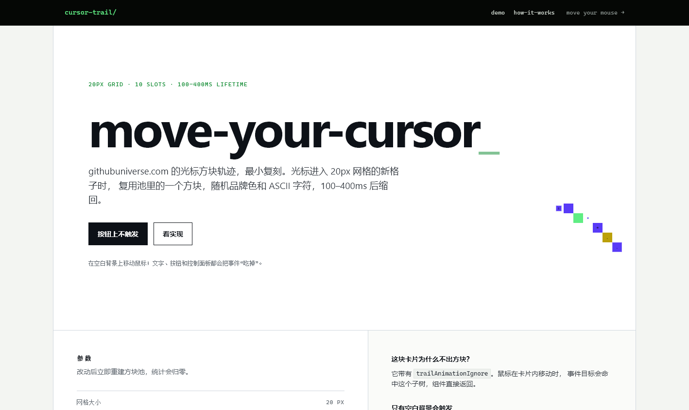

# cursor-trail/ · Демо следа из блоков GitHub Universe

[English](README.md) · [简体中文](README.zh-CN.md) · [繁體中文](README.zh-TW.md) · [日本語](README.ja.md) · [한국어](README.ko.md) · [Español](README.es.md) · [Français](README.fr.md) · [Deutsch](README.de.md) · [Português (Brasil)](README.pt-BR.md) · Русский

Воспроизведение без зависимостей следа из блоков, который следует за курсором на **githubuniverse.com**: когда указатель попадает в новую ячейку сетки 20 px, один блок из фиксированного пула используется повторно, получает случайный фирменный цвет и ASCII-символ и уменьшается через 100–400 мс.

Без сборки, без зависимостей и без фреймворков — три статических файла и один скрипт эффекта.



## Запуск

Откройте `index.html` напрямую или запустите статический сервер в папке:

```powershell
python -m http.server 8000
# откройте http://localhost:8000
```

> Эффект использует события мыши, поэтому на сенсорных устройствах он не срабатывает.

## Файлы

| Файл | Назначение |
| --- | --- |
| `index.html` | Страница демо: hero, панель параметров, объяснение |
| `styles.css` | Стили страницы + основной CSS следа |
| `trail.js` | Эффект; экспортирует `createCursorTrail()` |
| `demo.js` | Связывает панель параметров с `trail.js` |

## Поведение

- слушает `mousemove` только на элементах `.trailAnimationArea`;
- пропускает поддеревья `.trailAnimationIgnore`, `<a>`, `<button>`, элементы форм и листовые узлы только с текстом;
- округляет позицию указателя до `grid` и не срабатывает дважды в одной ячейке;
- повторно использует `pool` блоков, сохраняя постоянное число узлов DOM;
- при каждом срабатывании случайно выбирает цвет (6 фирменных цветов) и символ (11 ASCII-символов, с вероятностью 30 % — пустой);
- снимает `is-active` через `minLife`–`maxLife` мс; уменьшением занимается CSS;
- отключается при `prefers-reduced-motion: reduce`, в том числе при изменении настройки на лету.

## Соответствие оригинальному сайту

Эти данные получены статическим анализом production-бандла (оригинальный сайт не запускался):

| Оригинальный сайт | Это демо |
| --- | --- |
| Компонент `CursorTrailAnimation`, ленивая загрузка через `next/dynamic` (chunk `2834` + CSS `7583`) | `createCursorTrail()` в `trail.js` |
| Имена классов `trailAnimationArea` / `trailAnimationIgnore` | те же |
| Сетка 20 px, `Math.floor(clientX / 20) * 20` | по умолчанию `grid: 20`, меняется в панели |
| 10 блоков с `fixed`-позиционированием по кругу | по умолчанию `pool: 10` |
| 6 фирменных цветов `#ae85ff #f73678 #c05200 #583af7 #5fed83 #bba00a` | идентичны |
| 11 символов `- / ) . + = > < * & (` | идентичны |
| Случайное время жизни 100–400 мс | `minLife: 100` / `maxLife: 400` |
| `.Color` масштабируется `0 → 1` за 0,1 с | та же кривая и длительность |
| `mousemove` на десктопе, текст/ссылки/кнопки игнорируются | так же (ссылки и кнопки через `closest`) |

## Повторное использование

Подключите `trail.js` и правила `.trail-layer` / `.trail-block` из `styles.css`, затем:

```html
<section class="trailAnimationArea">
  <h1 class="trailAnimationIgnore">Заголовок не срабатывает</h1>
  <p>На этом пустом фоне будут появляться блоки.</p>
</section>

<script src="trail.js"></script>
<script>
  const trail = createCursorTrail({ grid: 20, pool: 10 });
</script>
```

### `createCursorTrail(options)`

| Параметр | По умолчанию | Описание |
| --- | --- | --- |
| `grid` | `20` | Размер сетки в px; он же размер блока |
| `pool` | `10` | Число блоков в пуле |
| `minLife` / `maxLife` | `100` / `400` | Диапазон времени жизни блока (мс) |
| `blankChance` | `0.3` | Вероятность, что блок будет без символа |
| `colors` | 6 фирменных цветов | Пул цветов |
| `glyphs` | 11 ASCII-символов | Пул символов |
| `areaSelector` | `.trailAnimationArea` | Области, где могут появляться блоки |
| `ignoreSelector` | `.trailAnimationIgnore` | Исключаемые поддеревья |
| `onChange` | `null` | Колбэк состояния с `{ spawned, active, reduced, paused }` |

Возвращает контроллер:

| Метод | Описание |
| --- | --- |
| `destroy()` | Удаляет слушатели, таймеры и DOM |
| `setPaused(value)` | Ставит след на паузу или возобновляет |
| `isReduced()` | Отключён ли он из-за уменьшения движения |
| `getState()` | Текущие счётчики |

## Намеренные отличия

- Оригинал — компонент React; это демо на чистом JS рисует блоки в фиксированном слое, а не в дереве React.
- Оригинал проверяет только `tagName` цели (`A`/`BUTTON`); здесь используется `closest`, поэтому потомки внутри ссылки тоже не срабатывают.
- В этом демо символы центрированы в блоке, добавлены панель параметров, счётчики и сетка-оверлей.
- Оригинал также слушает заголовки `River`; здесь этого нет. При необходимости добавьте `trailAnimationArea` заголовку.

## Проверено

Проверено в headless Chrome + CDP:

- движение по пустым областям создаёт блоки, счётчики совпадают с числом узлов `is-active`;
- области `trailAnimationIgnore` (заголовки, текст) не срабатывают, а после выхода след возобновляется;
- переключатель паузы работает, после возобновления блоки появляются снова;
- при эмуляции `prefers-reduced-motion: reduce` слой скрывается, слушатели удаляются, а на странице показывается уведомление;
- изменение сетки или размера пула синхронно обновляет число блоков и `--trail-size`.

`preview.png` — след, снятый во время этой проверки.

## Примечания

- Блоки имеют `position: fixed` и позиционируются в координатах вьюпорта, поэтому при прокрутке остаются выровненными по сетке 20 px.
- После выхода из области блоки ненадолго остаются до конца времени жизни; это оригинальное поведение, а не ошибка.
- События мыши внутри `iframe` не выходят наружу, поэтому над встроенным содержимым блоки не появляются.
